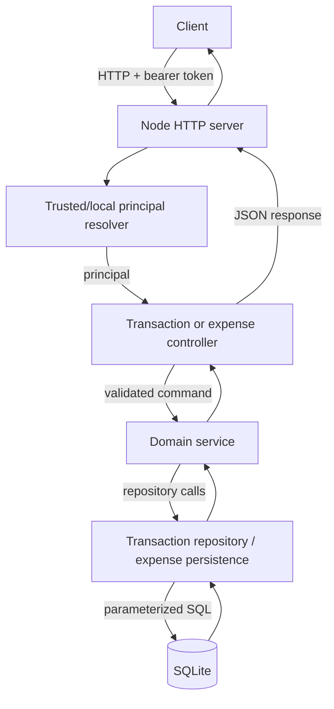

# FinTrack API Architecture

FinTrack uses TypeScript, Node.js, Better-SQLite3, and a layered API design.
Transaction and expense-splitting features share database infrastructure but keep separate domain services.
Transaction requests flow through `src/transactions/controller.ts`, `service.ts`, and `repository.ts`.
Expense requests flow through `src/controllers/expense-splitting.controller.ts` and balance-calculation service.
Models define data contracts; controllers validate HTTP input and resolve authenticated principals.
Services validate business rules; repositories isolate parameterized SQL and persistence details.
The Node HTTP adapter in `src/server.ts` maps HTTP traffic to the Fetch `Request`/`Response` handlers.
Shared-expense creation writes the expense and all participant shares in one database transaction.
Balance calculations use integer cents and apply deterministic remainder distribution for equal splits.
Every user-scoped operation checks the authenticated identity; list endpoints use bounded pagination.
This separation makes financial rules testable without HTTP or database coupling and limits unsafe data access.
SQLite constraints and parameterized statements provide an additional persistence-level correctness boundary.

## Request and data flow

